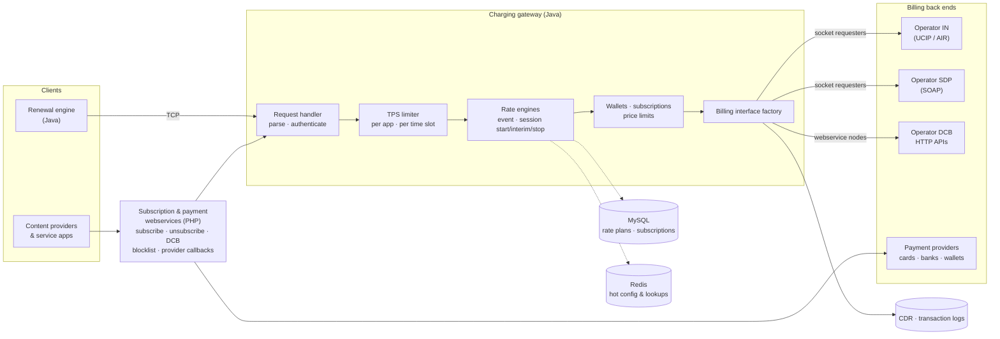
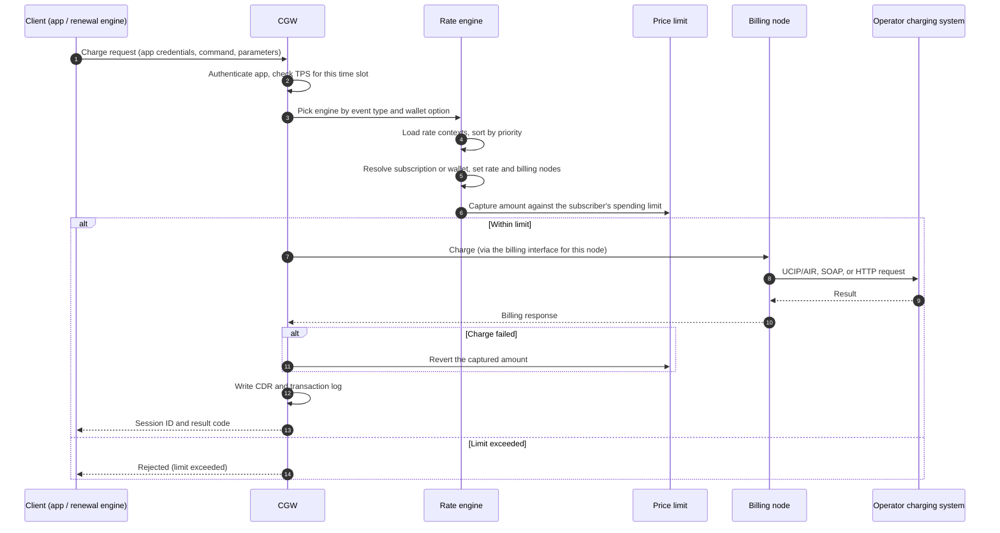
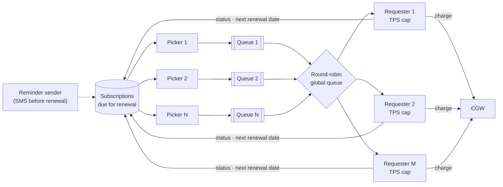
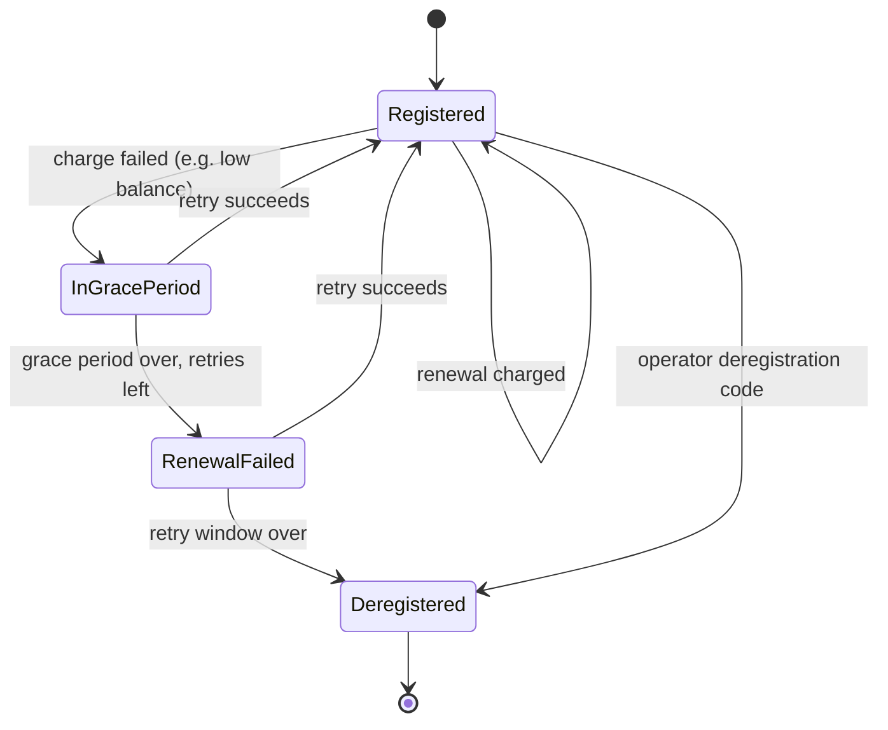

# Carrier Billing & Subscription Renewal Platform: Architecture Case Study

> **What this is:** a write-up of the **charging gateway (CGW)**, **subscription renewal engine**, and **payment webservices** I built and ran in production for mobile operators in **Bangladesh and Malaysia** (2019–2023, at SSD-TECH and Dotlines Bangladesh, which belong to the same group). Content providers use the platform to charge subscribers' mobile balance for digital services, one-off or on subscription. At its peak it handled **~500 TPS** of charging traffic and **~200,000 renewals a day** for **~30 services**.
> **What this is not:** source code. The code is proprietary, so this repository only documents the architecture, the decisions behind it, and my part in it. Hosts, credentials, operator and provider names, and subscriber data have been left out.

**Stack:** Java 8 · Gradle · TCP sockets · MySQL (HikariCP) · Redis · Log4j2 · SNMP · PHP webservices · SOAP / HTTP · UCIP/AIR (operator IN)

---

## 1. The product

Mobile operators let third-party services, such as news, games, education and music, bill subscribers through their **airtime balance**. This is called **direct carrier billing (DCB)**. Every operator exposes this differently: some through an **Intelligent Network (IN)** charging system over UCIP/AIR, some through a **service delivery platform (SDP)** over SOAP, and some through their own HTTP APIs.

The platform puts **one charging API** in front of all of them:

- **One-time charges** for a purchase or an event, and **session charging** (start, interim, stop) for metered usage
- **Subscriptions with auto-renewal**, including grace periods, retries, cheaper fallback packages, and renewal reminders
- **Rating** that turns an event into a price, based on rate plans, time slots, pulses, wallets, and spending limits
- **Payment-provider integrations** (card and bank gateways, mobile wallets, vouchers and top-up), so services can also take non-carrier payments
- **CDRs and transaction logs** for billing reconciliation and revenue sharing

## 2. Architecture

| Component | Responsibility |
|---|---|
| **Charging gateway (CGW)** | A Java TCP server. It authenticates each application, enforces throughput limits, rates the request, checks wallets, subscriptions, and spending limits, then sends the charge to the right **billing node** and writes a CDR. It includes session management, a monitored transaction state machine, SNMP, and a command interface for operations |
| **Billing interfaces** | Pluggable back ends picked per billing node. **Application** nodes talk to operator IN/SDP connectors over sockets. **Webservice** nodes call operator HTTP APIs. **Dummy** nodes return scripted results for testing |
| **Renewal engine** | A Java service that finds subscriptions due for renewal, charges them through the CGW at a controlled rate, and moves each subscription through its lifecycle states. It also sends renewal reminders by SMS |
| **Webservices** | Public APIs for subscribe, unsubscribe, and status, plus operator-specific DCB charging APIs. Integrations with payment providers, a CGW management API, and a **soft blocklist** that pauses charging for flagged numbers without unsubscribing them |

## 3. How a charge request flows

## 4. The rating model

- **Event types:** a **specific event** (a one-off charge) is rated once. **Sessions** are rated at **start**, then at **interim** updates, then at **stop**, so metered usage is charged as it happens and settled at the end.
- **Rate contexts in priority order:** one request can match several rate plans, such as a promotional price, a time-of-day price, or a default. Contexts are sorted by priority, and the first one that applies sets the rate and the billing nodes.
- **Pulses and time slots:** prices are defined per pulse (the billing unit) and can change by time slot. TPS limits are also set per application per time slot.
- **Wallets:** some services charge against internal wallets. When a charge spans wallets, the balances are cropped across them and the pulse size is adjusted to fit.
- **Charging modes:** *with subscription* (validates the subscriber's package), *with wallet*, or *plain*.
- **Price limits:** each subscriber has **monthly and yearly spending caps**, with optional carry-forward of unused monthly allowance. The amount is **captured** before charging and **reverted** if the charge fails, which works like a payment authorization.

## 5. The renewal engine

- **Pickers** pull due subscriptions from the database in bounded batches, each into its own queue. When a queue runs empty, its picker refills it.
- A **round-robin global queue** spreads requester threads across all picker queues, so no single slice of subscribers starves the others.
- Each **requester** has its own **TPS cap**, so the total charging rate stays within what the operator allows. Requesters only run inside **configured time windows**, which keeps charging away from restricted hours.
- **Reminders:** before a renewal, eligible subscribers get an SMS. Notification history is written in batches.

**Subscription lifecycle**

- **Downgrade before failing:** if a package allows it, a failed charge is retried at once on the configured **cheaper package**. That keeps the subscriber, at lower revenue, instead of losing them.
- An optional **eligibility check** with the operator runs before charging, so requests that are bound to fail are never sent.
- Retry timing, grace periods, and retry windows are configured **per package**.

## 6. Webservices and payment providers

- **Subscription APIs:** subscribe, unsubscribe, and status for service providers
- **Operator DCB APIs:** market-specific charging APIs, including the integrations that brought the platform to **Malaysia**
- **Payment providers:** card and bank payment gateways, mobile wallets, voucher and top-up systems, and international online payments, each with its own callback handling
- **Soft blocklist:** temporarily stops charging specific numbers (after complaints or fraud flags) without losing their subscriptions
- **CGW management API:** onboarding applications, packages, and rate plans

## 7. My role

| | Work |
|---|---|
| **Built (owner)** | **Charging gateway core:** request pipeline, rate engines, wallets, price limits, TPS limits, billing-interface factory, CDR and transaction logs · **Renewal engine:** picker/queue design, TPS-capped requesters, lifecycle state machine, downgrade and eligibility flows, reminders, crash-safe in-flight tracking · **Webservices:** subscription and DCB APIs, payment-provider integrations, soft blocklist, the Malaysian operator integrations, and the deployment and API documentation |
| **Maintained** | Platform upgrades, including moving to **Log4j2** after Log4Shell and upgrading to the MySQL 8 connector |
| **Team-built** | The operator IN/SDP socket connectors and the Redis data-sync service |

## 8. Results

| Metric | Approximate figure |
|---|---|
| Charging gateway throughput | **~500 TPS** |
| Subscription renewals | **~200,000 per day** |
| Services billed through one API | **~30** |
| Markets | **2 countries** (Bangladesh, Malaysia) |

- **Production carrier billing** for operators in **two countries**, behind one charging API
- **~200K automated renewals a day**, with grace periods, retries, downgrade fallback, and reminders, paced to stay within operator limits
- **Pluggable billing back ends**, so adding an operator or payment provider meant adding a node, not changing the core
- Spending limits with capture and revert, plus per-application TPS limits, to protect both subscribers and operator systems

More detail: [docs/engineering-decisions.md](docs/engineering-decisions.md) · Related: [SMSC over SS7/SIGTRAN case study](https://github.com/shubhajit93/telecom-smsc-platform-case-study). The SMS gateway charges each message through this CGW.

---

📫 [GitHub profile](https://github.com/shubhajit93) · [LinkedIn](https://www.linkedin.com/in/shubhajit-nandi/)
